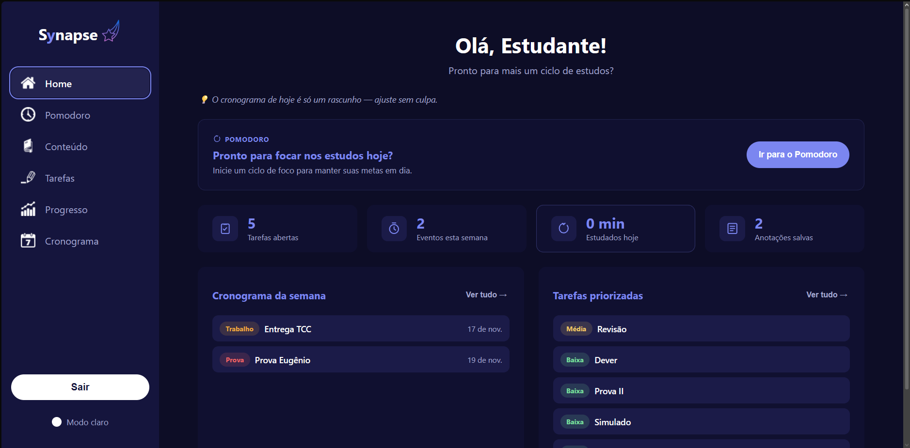

<div align="center">

# Synapse

**Aplicação web de produtividade para estudantes: organize tarefas, foque com Pomodoro, guarde anotações e acompanhe seu progresso em um só lugar.**


**[Ver demonstração online](https://synapse-sigma-swart.vercel.app)**

</div>

---

## Sobre o projeto

O **Synapse** nasceu como Trabalho de Conclusão de Curso (TCC) em Ciência da Computação, com a proposta de reunir em uma única interface as ferramentas que um estudante usa no dia a dia: lista de tarefas com prioridade automática, temporizador de foco, calendário de provas e entregas, repositório de anotações e métricas de estudo.

A ideia central é reduzir a fricção de organizar os estudos. Em vez de decidir manualmente o que fazer primeiro, o Synapse calcula a prioridade de cada tarefa a partir do prazo, da dificuldade e do volume de conteúdo.

Cada estudante tem a própria conta, e os dados ficam isolados por usuário: ninguém vê as tarefas, anotações ou sessões de estudo de outra pessoa.

## Demonstração

Acesse a versão online: **[synapse-sigma-swart.vercel.app](https://synapse-sigma-swart.vercel.app)**

Para testar sem criar conta, clique em **"Só quero testar: entrar na conta de demonstração"** na tela de login. A conta demo é compartilhada entre visitantes, e nela não é possível alterar dados de acesso nem excluir a conta.



## Funcionalidades

| Módulo | O que faz |
| --- | --- |
| **Landing page** | Página de apresentação do Synapse, com animações, antes de acessar o app. |
| **Contas** | Cadastro e login por e-mail e senha ou com Google, confirmação de e-mail, recuperação de senha e opção "lembrar de mim". |
| **Minha conta** | Alteração de nome, e-mail (com confirmação no novo endereço) e senha, além da exclusão da conta junto com todos os dados. |
| **Home** | Painel com resumo do dia, tarefas prioritárias, próximos eventos da semana, minutos estudados e frases motivacionais. |
| **Pomodoro** | Temporizador de foco (25 min), descanso curto (5 min) e descanso longo (15 min, a cada 4 ciclos). Pode ser vinculado a uma tarefa ativa, e cada sessão concluída é registrada. |
| **Tarefas** | CRUD de tarefas com três visualizações: **lista**, **Kanban** e **Matriz de Eisenhower** (fazer, planejar, delegar, eliminar). |
| **Conteúdo** | Anotações por disciplina e categoria (Resumo, Exercício, Revisão, Dúvida), com link útil e filtro por disciplina. |
| **Cronograma** | Calendário mensal para provas, trabalhos, cursos e outros eventos, com marcação de concluído e situação (atrasado, hoje, futuro). |
| **Progresso** | Estatísticas dos últimos 7 dias, meta diária de estudo (120 min) e sequência de dias estudando. |

Outros detalhes:

- Dados isolados por usuário no Firestore, protegidos por regras de segurança.
- Ações sensíveis (trocar e-mail, trocar senha, excluir conta) pedem a senha atual ou a confirmação do Google.
- Tema claro e escuro, alternável pela barra lateral.
- Layout responsivo: barra lateral no desktop e navegação inferior no celular.
- Cache local persistente do Firestore, permitindo uso com conexão instável e sincronização entre abas.
- Interface em português do Brasil.

### Como a prioridade é calculada

A pontuação de cada tarefa (0 a 10) é uma média ponderada de três fatores:

| Fator | Peso | Como entra no cálculo |
| --- | --- | --- |
| Urgência | 50% | Quanto mais próximo o prazo, maior a nota. A urgência chega a zero com 10 ou mais dias de folga. |
| Dificuldade | 25% | Escala de 1 a 5 convertida para 0 a 10. |
| Quantidade de conteúdo | 25% | Escala de 1 a 5 convertida para 0 a 10. |

O resultado classifica a tarefa como prioridade **baixa** (abaixo de 4), **média** (de 4 a 7) ou **alta** (7 ou mais). A Matriz de Eisenhower usa a mesma urgência, combinada com a média entre dificuldade e conteúdo como "importância".

## Tecnologias

- [React 19](https://react.dev/)
- [Vite](https://vite.dev/)
- [Firebase Authentication](https://firebase.google.com/docs/auth) (e-mail/senha e Google)
- [Firebase Firestore](https://firebase.google.com/docs/firestore) (banco de dados)
- [Framer Motion](https://motion.dev/) (animações da landing page)
- CSS puro com variáveis de tema
- ESLint e Oxlint para análise estática

## Estrutura do projeto

```
Synapse/
├── public/                  # Logo e ícones
├── src/
│   ├── components/
│   │   ├── Landing/         # Página de apresentação
│   │   ├── login/           # Login, cadastro e confirmação de e-mail
│   │   ├── Conta/           # Minha conta (editar dados e excluir conta)
│   │   ├── Home/
│   │   ├── Pomodoro/
│   │   ├── Tarefas/         # Lista, Kanban e Matriz de Eisenhower
│   │   ├── Conteudo/
│   │   ├── Cronograma/
│   │   ├── Progresso/
│   │   ├── Sidebar/
│   │   └── icons/
│   ├── context/             # Contexto da tarefa ativa (Pomodoro ↔ Tarefas)
│   ├── services/            # Firebase: autenticação e acesso ao Firestore
│   ├── styles/              # Tema claro/escuro
│   ├── utils/               # Prioridade, calendário e agrupamento de eventos
│   ├── App.jsx
│   └── main.jsx
├── firestore.rules          # Regras de segurança do Firestore
├── index.html
├── vite.config.js
└── package.json
```

## Como executar

### Pré-requisitos

- [Node.js](https://nodejs.org/) 20 ou superior
- Um projeto no [Firebase](https://console.firebase.google.com/) com:
  - **Firestore** habilitado
  - **Authentication** com os provedores **E-mail/senha** e **Google** ativados

### Instalação

```bash
# 1. Clone o repositório
git clone https://github.com/jmpinho/Synapse.git
cd Synapse

# 2. Instale as dependências
npm install
```

### Configuração do Firebase

Crie um arquivo `.env.local` na raiz do projeto com as credenciais do seu app web do Firebase:

```env
VITE_FIREBASE_API_KEY=sua_api_key
VITE_FIREBASE_AUTH_DOMAIN=seu-projeto.firebaseapp.com
VITE_FIREBASE_PROJECT_ID=seu-projeto
VITE_FIREBASE_STORAGE_BUCKET=seu-projeto.firebasestorage.app
VITE_FIREBASE_MESSAGING_SENDER_ID=000000000000
VITE_FIREBASE_APP_ID=1:000000000000:web:xxxxxxxxxxxxxxxx
```

Sem as variáveis `VITE_DEMO_*`, o botão da conta de demonstração não aparece.

Os dados de cada usuário ficam em `usuarios/{uid}`, divididos em quatro subcoleções criadas automaticamente no primeiro uso:

| Subcoleção | Conteúdo |
| --- | --- |
| `tarefas` | Título, data de entrega, dificuldade, quantidade de conteúdo e status |
| `eventos` | Título, tipo, data, descrição e se foi concluído |
| `conteudos` | Anotações por disciplina e categoria |
| `sessoesEstudo` | Sessões de Pomodoro concluídas (tarefa e minutos) |

### Regras de segurança

O arquivo [`firestore.rules`](firestore.rules) garante que cada usuário só leia e escreva os próprios dados. Para aplicá-lo, copie o conteúdo para **Firestore Database → Regras** no console do Firebase e clique em **Publicar**.

> **Atenção:** nunca publique o `.env.local` no repositório.

### Executando

```bash
npm run dev
```

A aplicação ficará disponível em `http://localhost:5173`.

### Scripts disponíveis

| Comando | Descrição |
| --- | --- |
| `npm run dev` | Inicia o servidor de desenvolvimento |
| `npm run build` | Gera o build de produção em `dist/` |
| `npm run preview` | Serve localmente o build de produção |
| `npm run lint` | Executa o ESLint |

## Roadmap

- [x] Autenticação de usuários (e-mail/senha e Google)
- [x] Logout e página "Minha conta"
- [x] Confirmação de e-mail no cadastro
- [x] Dados isolados por usuário e regras de segurança do Firestore
- [x] Exclusão de conta com remoção dos dados
- [ ] Termos de uso e política de privacidade (LGPD)
- [ ] Testes automatizados do cálculo de prioridade
- [ ] Rotas com URL (botão "voltar" do navegador)
- [ ] Notificações de prazos e fim de ciclos do Pomodoro

## Autor

**João Mateus Pinho da Silva**
Bacharel em Ciência da Computação

[](https://github.com/jmpinho)
[](https://www.linkedin.com/in/joao-mateus-pinho)
